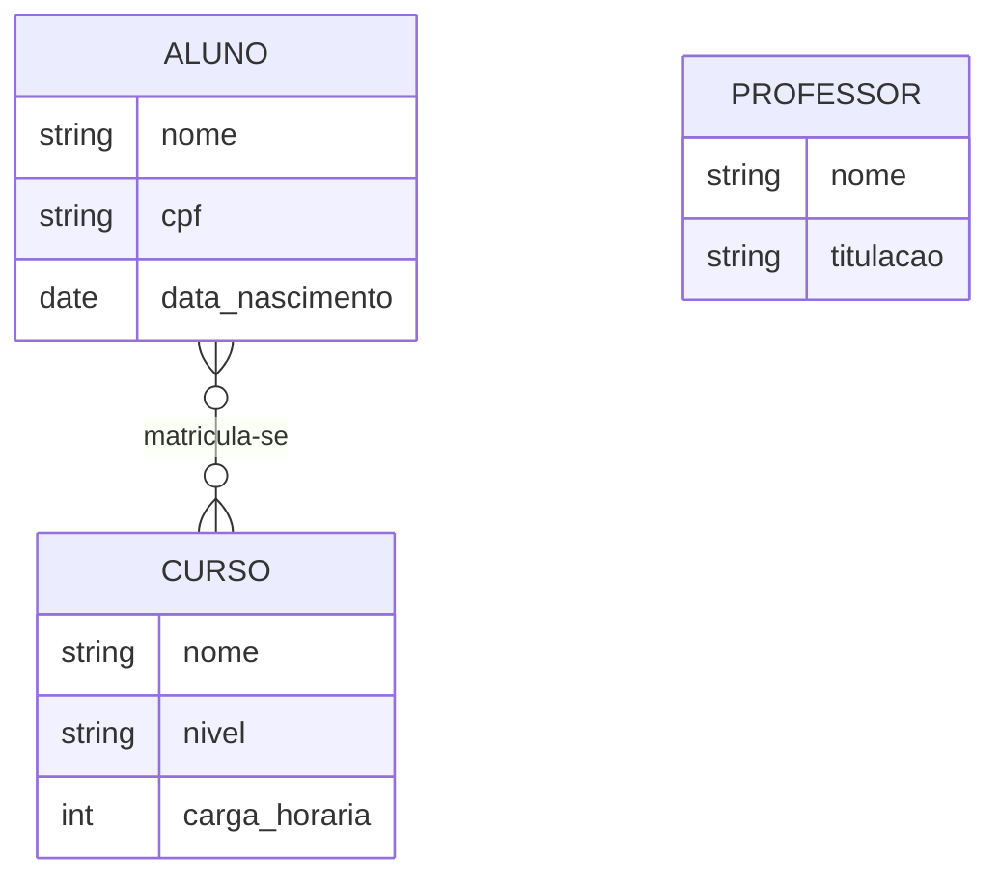

entendendo a diferença das estruturas de DER e MER
DER (Diagrama de Entidade-Relacionamento)
o DER representa visualmente os elementos de um sistema
o exemplo que iremos utilizar será p/a área educacional
por exemplo:
aluno:nome,cpf e data nascimento
curso:nome,nível e carga horária
professor:nome e titulação
relacionamentos:
um aluno pode se matricular em vários cursos
um curso pode ter vários alunos matriculados
este processo permite gerar uma visão c as informações se conectam antes de criar as tabelas no banco de dados

