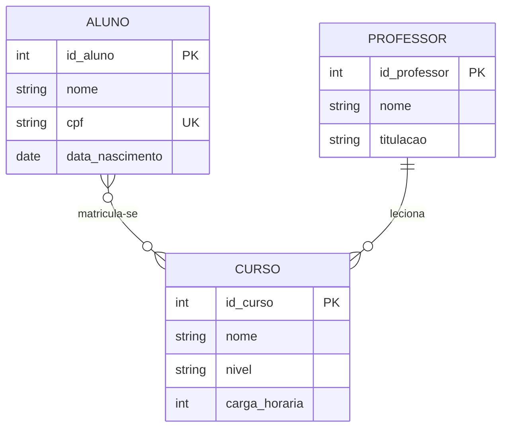
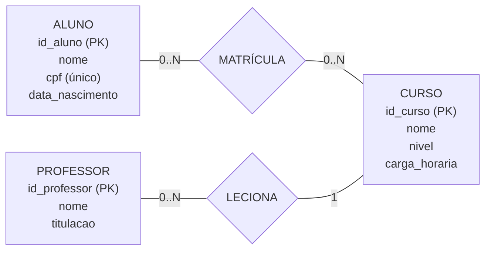

# MER e DER: exemplo da área educacional

O **MER (Modelo Entidade-Relacionamento)** descreve os dados de um sistema por meio de entidades, atributos e relacionamentos. Ele também pode especificar chaves e tipos de dados.

O **DER (Diagrama Entidade-Relacionamento)** é uma representação visual desse modelo, mostrando como as entidades se conectam.

Neste exemplo, as entidades são **Aluno**, **Curso** e **Professor**:

- Um aluno pode se matricular em vários cursos, e um curso pode ter vários alunos.
- Um professor pode lecionar vários cursos. Neste exemplo, cada curso tem um professor responsável.

## MER em Mermaid

O diagrama a seguir detalha atributos, tipos de dados e chaves. A matrícula entre aluno e curso é muitos-para-muitos.

## Outra visualização do DER

Esta versão usa um fluxograma para destacar os atributos dentro de cada entidade e os relacionamentos como losangos. As cardinalidades indicam quantas ocorrências podem participar de cada relacionamento.

